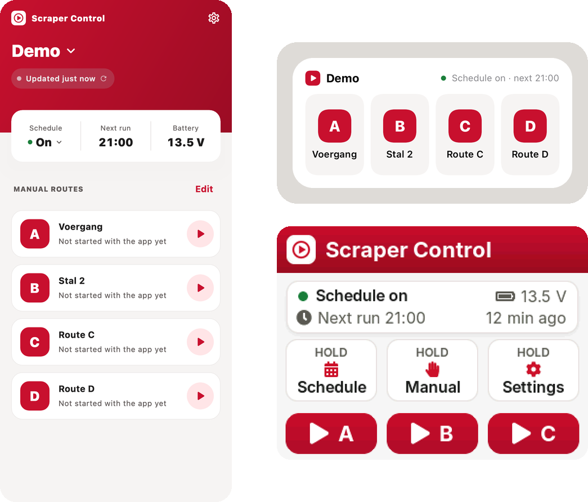

# Scraper Control

Control your manure scraper robot with three physical buttons, a phone or computer app, or a
Python script.

- **Buttons** (M5Stack): one route per button; hold for the schedule, manual driving and
  settings. Wifi is set up on the device itself, and it updates itself from the signed releases.
- **Apps** for Android, iOS and desktop: routes, schedule, live status, logbook, the robot's own
  panel, home-screen widgets, Siri/Shortcuts. Dutch and English.
- **Python**: the same robot API for scripts.
- **Web API**: the buttons and the desktop app answer a small HTTP API on the local network, for
  apps and tools out of Bluetooth range ([docs/API.md](docs/API.md)).
- **Web page**: the desktop app serves the same app to browsers on the local network, for a
  phone or computer without the app (Settings > Web page and API).
- **Safety**: a route button during a route stops it; a "finish the route?" question after a
  stop is always answered by a person; the schedule is left the way it was found.

<p>
  
</p>

## Supported robots

| Robot | Connection | Driver |
|---|---|---|
| Lely Discovery | Bluetooth LE, or classic Bluetooth on older robots (not on iOS) | [`drivers/lely`](drivers/lely) |

## Install

Everything is in the [latest release](https://github.com/ESchouten/scraper-control/releases/latest).

| Device | File | How |
|---|---|---|
| Android | `.apk` | Open it on the phone and allow installing from your browser or files app. A newer version installs over the old one; [Obtainium](https://github.com/ImranR98/Obtainium) with this repository keeps it up to date. |
| Windows | `.exe` | Not signed: at the blue warning choose More info > Run anyway. |
| macOS | `.dmg` | Not signed: drag the app to Applications, then right-click > Open the first time and allow Bluetooth. |
| Linux | `.deb` | From the apt repository below, so `apt upgrade` brings new versions, or `sudo apt install ./scraper-control_*.deb`. |
| iOS | none yet | Build it with Xcode ([native/README.md](native/README.md)). |
| Buttons | M5Stack Basic v2.7 (16 MB) | The first time with the [browser installer](https://eschouten.github.io/scraper-control/) (Chrome or Edge on a computer, USB-C data cable), or `esptool write-flash 0x0 scraper-control-m5stack-core-<version>-full.bin`. That erases the M5Stack; after that it updates itself over wifi. |

Linux apt repository:

```bash
sudo curl -fsSLo /etc/apt/keyrings/scraper-control.asc https://eschouten.github.io/scraper-control/apt/scraper-control.asc
echo "deb [signed-by=/etc/apt/keyrings/scraper-control.asc] https://eschouten.github.io/scraper-control/apt ./" | sudo tee /etc/apt/sources.list.d/scraper-control.list
sudo apt update && sudo apt install scraper-control
```

### First connection

1. The robot takes one Bluetooth connection at a time: close any other app that is connected
   to it.
2. **App**: it searches for the robot by itself and asks for the robot's PIN. The very first
   connection syncs with the robot, about 1.5 minutes, once.
3. **Buttons**: hold the right button for the settings: PIN, Robot (pick it from a search) and
   Wifi (a network or WPS). With wifi the buttons look for updates by themselves and serve the
   [web API](docs/API.md).

### The buttons

| | Tap | Hold |
|---|---|---|
| Left | Route A | Schedule on / off |
| Middle | Route B | Drive by hand |
| Right | Route C | Settings |

## How it fits together

| Folder | What |
|---|---|
| `core/` | The robot API (`scraper_c.h`), the same for every robot |
| `drivers/` | One folder per robot type: everything specific to that robot |
| `firmware/` | The M5Stack buttons (PlatformIO) |
| `native/` | The apps: shared Kotlin, Compose for Android and desktop, SwiftUI for iOS ([README](native/README.md)) |
| `python/` | The Python library `scraper_control` and the command line `scraper.py` |
| `tools/` | Build secrets |

Every client only provides the link to the robot (bytes in, bytes out); the driver says which
kind of link it needs. A new robot type is a new folder in `drivers/`.

## Build

```bash
python3 tools/secrets.py                          # once: build secrets from ~/.scraper-control/secrets
cd firmware && pio run -e m5stack-core -t upload  # the buttons (USB the first time)
cd native && ./gradlew :composeApp:run            # the desktop app (see native/README.md)
cd python && pip install -e . && python scraper.py --scan
```

Without build secrets everything builds and the tests pass, but a real robot may refuse to
connect.

## Tests

```bash
python3 tests/test_firmware.py                    # the buttons' firmware on a computer
for t in drivers/*/tests/test_*.py; do python3 $t; done  # each driver against its simulated robot
cd native && ./gradlew :shared:jvmTest :composeApp:jvmTest
```

GitHub Actions runs them on every push. A release (Actions > release) puts the signed firmware,
its first-install image, the Android APK and the desktop apps in one GitHub release, and the
buttons' browser installer (`docs/install`) on GitHub Pages; the buttons install it themselves.

## Licence and disclaimer

GNU AGPL v3 (`LICENSE`). Copyright (C) 2026 Erik Schouten.

Unofficial software: not made, endorsed or supported by the makers of the robots it controls.
Brand and product names belong to their owners. Use at your own risk and keep the robot in sight.
