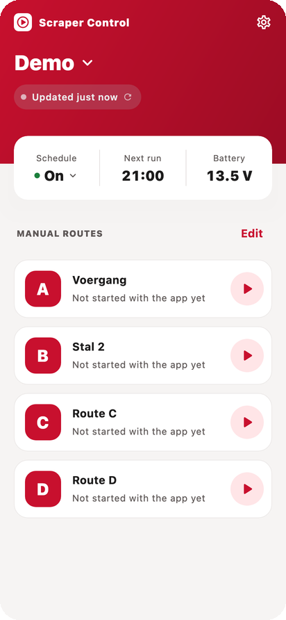
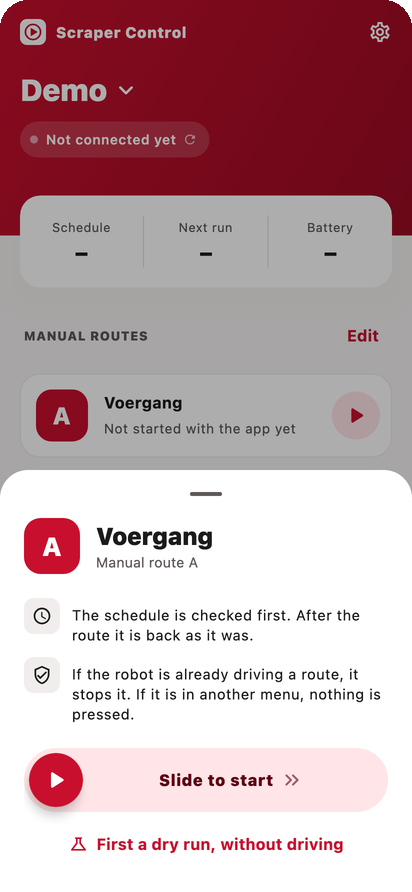
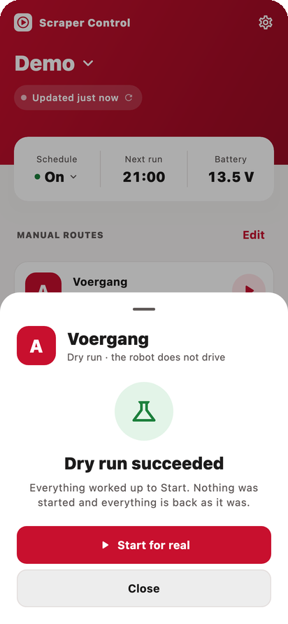
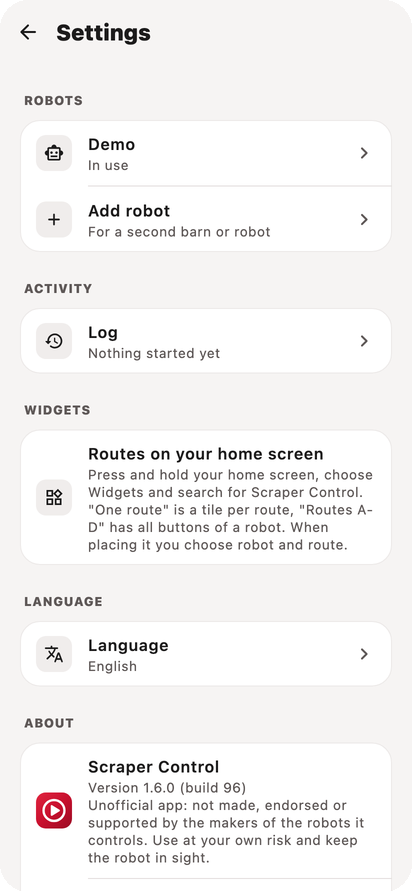
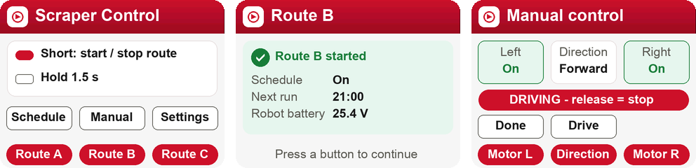

# Scraper Control

Control your manure scraper robot with three physical buttons, a phone or computer app, or a
Python script.

- **Buttons** (M5Stack): one route per button; hold for the schedule, manual driving and
  settings. Wifi is set up on the device itself, and it updates itself from the signed releases.
- **Apps** for Android, iOS and desktop: routes, schedule, live status, logbook, the robot's own
  panel, home-screen widgets, Siri/Shortcuts. Dutch and English.
- **Python**: the same robot API for scripts.
- **Safety**: a route button during a route stops it; a "finish the route?" question after a
  stop is always answered by a person; the schedule is left the way it was found.

<p>
  
  
  
  
</p>
<p>
  
</p>

## Supported robots

| Robot | Connection | Driver |
|---|---|---|
| Lely Discovery | Bluetooth LE | [`drivers/lely`](drivers/lely) |

## How it fits together

| Folder | What |
|---|---|
| `core/` | The robot API (`scraper_c.h`), the same for every robot |
| `drivers/` | One folder per robot type: everything specific to that robot |
| `firmware/` | The M5Stack buttons (PlatformIO) |
| `native/` | The apps: shared Kotlin, Compose for Android and desktop, SwiftUI for iOS ([README](native/README.md)) |
| `python/` | The Python library `scraper_control` and the command line `scraper.py` |
| `tools/` | Build secrets and publishing |

Every client only provides the link to the robot (bytes in, bytes out); the driver says which
kind of link it needs. A new robot type is a new folder in `drivers/`.

## Build

```bash
python3 tools/secrets.py                          # once: build secrets from ~/.scraper-control/secrets
cd firmware && pio run -e m5stack-core -t upload  # the buttons (USB the first time)
cd native && ./gradlew :composeApp:run            # the desktop app (see native/README.md)
cd python && pip install -e . && python scraper.py --scan
```

Without build secrets everything builds and the tests pass, but a real robot may refuse to
connect.

## Tests

```bash
python3 tests/test_firmware.py                    # the buttons' firmware on a computer
for t in drivers/*/tests/test_*.py; do python3 $t; done  # each driver against its simulated robot
cd native && ./gradlew :shared:jvmTest :composeApp:jvmTest
```

GitHub Actions runs them on every push. A release (Actions > release) puts the signed firmware,
the Android APK and the desktop apps in one GitHub release; the buttons install it themselves.

## Licence and disclaimer

GNU GPL v3 (`LICENSE`). Copyright (C) 2026 Erik Schouten.

Unofficial software: not made, endorsed or supported by the makers of the robots it controls.
Brand and product names belong to their owners. Use at your own risk and keep the robot in sight.
